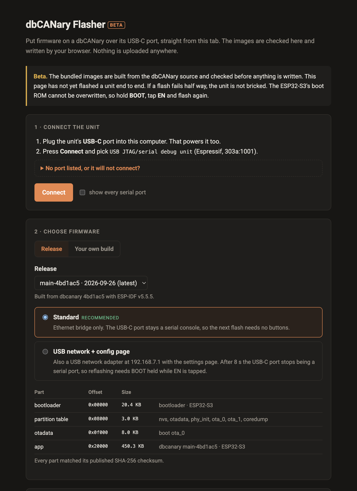

> **AI-assisted project.** This codebase was created with [Claude](https://claude.com/claude-code)
> (Anthropic), directed and reviewed by a human author.
> **Not yet proven on a unit.** The image checks, the manifest and the MD5 that verifies each write
> are covered by tests against the real bundled images. I've driven the page in a browser as far as
> connecting, and no further. **No CANary has been flashed from it yet.**

# CANary Flasher

A static web page that puts firmware on a [CANary](https://stoatworks-labs.com/hardware/canary/)
over its USB-C port, straight from a browser tab. You don't need to install a toolchain, a driver
or Python first.

It's live at **<https://canary-flasher.stoatworks-labs.com>**. It needs Web Serial, which means desktop Chrome, Edge or Opera.



## What it does

| | |
|---|---|
| **Flash a release** | Pick a bundled release and a variant (*Standard*, or *USB network + config page*). Every part is checked against its published SHA-256 checksum before it is shown. |
| **Flash your own build** | Choose the `.bin` files from an ESP-IDF build directory. Each is identified by its **contents**, not its name, and put at the offset its kind belongs at. A lone `canary.bin` gets a blank otadata written beside it, so the unit boots what you just wrote rather than whatever it last updated to over the air. |
| **Say what the unit is running** | On connect it reads the chip, MAC and flash size, and also otadata and the active slot's app descriptor, so you see the version before you overwrite it. |
| **Serial console** | Watch the unit boot after flashing. |

## What it refuses

The page checks all of this before it writes anything (`checkPlan()` in [src/image.ts](src/image.ts)),
and the test suite runs the same checks over every bundled image:

- a chip other than an ESP32-S3, or less than 8 MB of flash;
- an image built for another chip;
- an app whose project name isn't `canary` (or `dbcanary`, from before the rename), unless you tick the override;
- a bootloader anywhere but `0x0`, or an app below `0x20000`;
- overlapping writes, offsets off a 4 KB sector, or anything past the end of flash.

Every write is then verified by esptool's MD5 read-back.

## If a unit will not connect

A unit running the **USB network** firmware turns its USB-C port into a network adapter 8 s after
boot, and after that there's no serial port to talk to. Hold **BOOT**, tap **EN**, release **BOOT**
and connect. The ESP32-S3's boot ROM can't be overwritten, so you can always recover a flash that
fails half way like this.

## Bundled firmware

`public/firmware/` holds the release images and `manifest.json`, and only
`scripts/import-firmware.ts` writes them. It reads a build's own `flasher_args.json`, so nobody types
an offset by hand, and it refuses anything the page would refuse:

```bash
node scripts/import-firmware.ts --build <idf build dir> --release main-<sha> \
  --variant standard --name "Standard" --summary "…" --commit <full sha> --recommended
```

Two releases are bundled. **main-ff4110d** (the default) is the first under the CANary name:
R1 lists a unit as `CANary` rather than `db-70`, and the USB adapter is called CANary. It differs
from the one below only in its names, and it hasn't been flashed onto a unit yet.
**main-60a871f** is the last release proven on a board (Ethernet and USB, acceptance test
19/19). Its app still carries the pre-rename project name `dbcanary`, which the page accepts.

The firmware images are built from the CANary source and **aren't** covered by this repository's
MIT licence, which applies to the flasher itself.

## Develop

```bash
npm install
npm run dev      # vite
npm test         # vitest
npm run build    # tsc -b && vite build -> dist/
```

It's built on [esptool-js](https://github.com/espressif/esptool-js) (Apache-2.0).

<!-- attributions:start -->
This project is built on other people's work — see [ATTRIBUTIONS.md](ATTRIBUTIONS.md).
<!-- attributions:end -->
